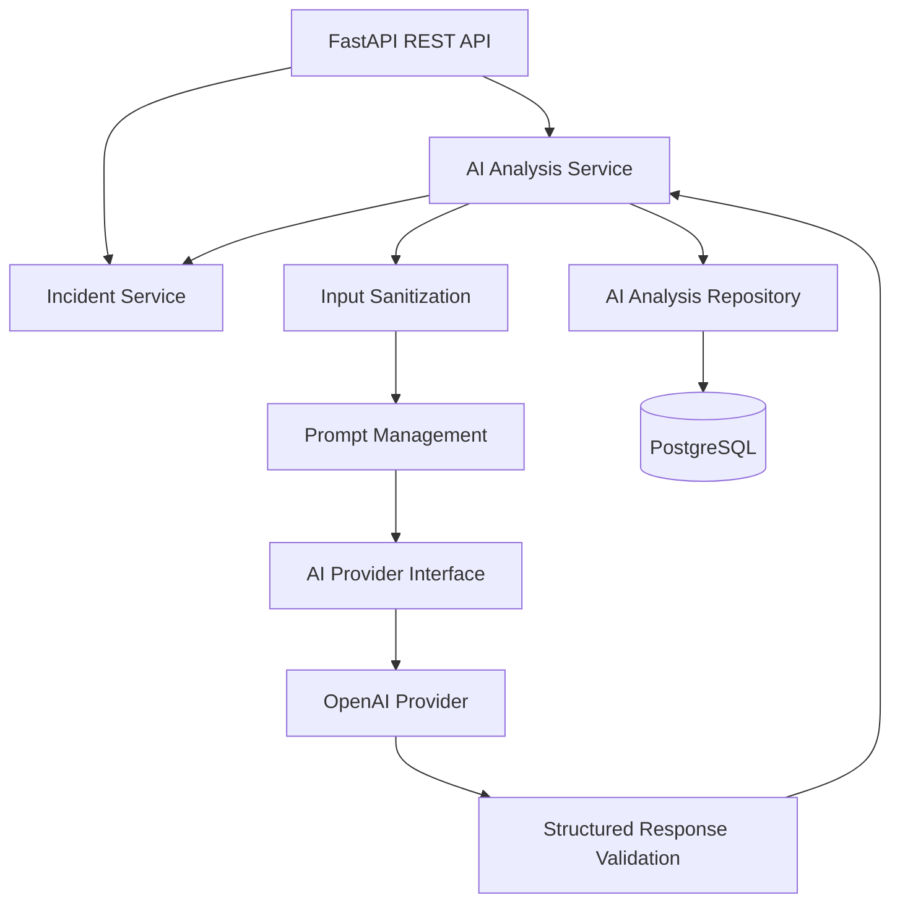

# AI Integration Architecture

## 1. Overview

The AI integration layer extends the existing incident management
backend with intelligent incident analysis capabilities.

The implementation follows the modular monolith architecture
established in the original system architecture.

## 2. Stage 6 Objectives

- Suggest incident categories.
- Recommend incident priorities and severity levels.
- Generate concise incident summaries.
- Explain the reasoning behind recommendations.
- Identify insufficient evidence and uncertainty.
- Persist AI analysis results and operational metadata.
- Allow support engineers to override recommendations.
- Establish a reusable AI provider abstraction.

Log analysis and diagnostic evidence enrichment are implemented
in Stage 7. Documentation-backed troubleshooting, vector
retrieval, and remediation workflows remain future work.

## 3. Provider Strategy

OpenAI is the initial AI provider, consistent with the original
software requirements.

Application services will interact with a provider-independent
interface rather than directly depending on a vendor SDK.

The initial implementation will support one provider while
preserving the ability to integrate additional providers later.

Model selection will be configurable through environment settings.

## 4. Component Architecture

## 5. AI Analysis Response

The proposed structured analysis contract includes:

- Suggested category
- Recommended priority
- Recommended severity
- Incident summary
- Recommendation justification
- Confidence score
- Insufficient evidence indicator
- Missing information
- Provider identifier
- Model identifier
- Prompt version
- Input token usage
- Output token usage
- Estimated processing cost
- Request latency
- Analysis timestamp

Confidence scores represent model-reported uncertainty and must
not be interpreted as statistically calibrated probabilities.

Provider metadata and operational measurements will be populated
by the application rather than generated by the language model.

All model-generated output must pass application validation
before persistence or presentation.

## 6. Human Oversight

AI-generated classifications and priority recommendations are
advisory.

The AI system must not automatically modify an incident's
authoritative priority, category, status, or resolution.

Support engineers retain control over incident modifications.

No remediation commands or external tools will be executed
automatically during Stage 6.

## 7. Security

- Store API credentials outside source control.
- Represent API credentials using secret-aware configuration.
- Never log API keys or authorization headers.
- Sanitize incident text before external processing.
- Apply bounded input and output sizes.
- Treat incident content as untrusted data.
- Separate system instructions from incident content.
- Validate all model-generated responses.
- Avoid using real customer data in development demonstrations.
- Do not expose the unauthenticated AI API publicly.

Prompt injection defenses and sanitization are defense-in-depth
measures and do not guarantee complete protection.

Authentication and role-based authorization remain required
before production deployment.

## 8. Reliability

AI functionality must degrade gracefully when the external
provider becomes unavailable.

The existing incident management API must remain operational
without valid AI credentials or an available AI provider.

External requests will use configurable timeouts and bounded
retries for transient failures.

Permanent validation, authentication, and configuration errors
must not be retried unnecessarily.

Retry ownership must be explicit to prevent compounded retries
between the provider SDK and application services.

External AI requests should not hold open database transactions.

## 9. Operational Metadata

AI analysis records should capture:

- Provider and model identifiers
- Prompt version
- Analysis timestamp
- Request latency
- Token usage when available
- Estimated cost when pricing information is configured
- Analysis execution status
- Sanitized failure information

Estimated cost must be distinguished from actual provider billing.

Missing usage or pricing information must not be represented as
a confirmed zero cost.

## 10. Testing Strategy

Automated testing will include:

- AI configuration validation
- Provider abstraction behavior
- Structured response validation
- Prompt construction
- Input sanitization
- Incident classification
- Incident summarization
- Priority recommendations
- Timeout and retry handling
- Provider error translation
- AI analysis persistence
- API integration testing
- AI response quality evaluations

Unit tests and standard continuous integration must not require
paid external API requests.

Provider responses will be mocked for deterministic automated
testing.

Optional live provider tests will be explicitly enabled and
executed separately using synthetic incident data.

AI quality evaluations will use representative synthetic
incidents and defined expected outcomes.

## 11. Acceptance Criteria

Stage 6 is complete when:

1. AI configuration is validated and credentials are protected.
2. The AI provider interface and initial OpenAI implementation
   are operational.
3. Incident analysis produces validated structured responses.
4. AI recommendations do not automatically modify incidents.
5. Analysis results and operational metadata are persisted.
6. Provider failures are handled gracefully.
7. Existing incident operations remain independent of AI
   availability.
8. Automated tests and static quality checks pass.
9. Application statement coverage meets the configured CI
   requirement. The original Stage 6 threshold was 80%;
   the Stage 7 workflow now requires exact 100% coverage.
10. AI response quality is evaluated using synthetic incidents.
11. A controlled live provider request is verified separately
    when paid access and explicit authorization are available.
    This original acceptance item remains deferred.
12. Technical documentation and API documentation are updated.
13. GitHub Actions passes before the feature branch is merged.

The current CI requirement is exact 100% application statement
coverage with zero failed, errored, or skipped tests. This is
not a guarantee of comprehensive behavioral or security coverage.

## 12. Implementation Status

Status: Stage 6 implemented; Stage 7 extension verified through
local Windows and isolated Linux regression.
Application Version: 0.1.0

This document preserves the original AI integration design.
Persistent incident analysis and optional log-enhanced analysis
are implemented. Live provider evaluation remains deferred.

Local Linux CI-equivalent acceptance has passed. Actual GitHub
Actions execution and Stage 7 branch integration remain pending.

See [AI Integration](ai-integration.md) and
[Log Ingestion Architecture](log-ingestion-architecture.md).
