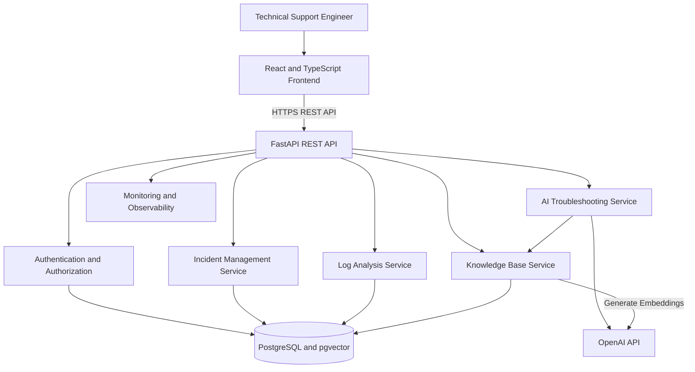
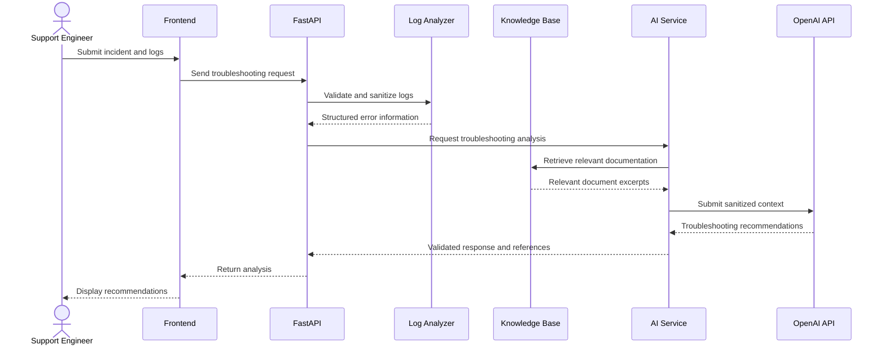

# AI Support Engine - System Architecture

## 1. Architecture Overview

AI Support Engine follows a modular monolith architecture
that separates presentation, application logic, business
services, data persistence, and external integrations.

This approach reduces initial infrastructure complexity
while maintaining clear module boundaries and supporting
future architectural expansion.

## 2. High-Level System Design

## 3. Application Layers

### 3.1 Presentation Layer

Technology: React and TypeScript

Responsibilities:

- User authentication interface.
- Incident management dashboard.
- Application log submission.
- AI troubleshooting interface.
- Knowledge base administration.
- Application metrics visualization.

### 3.2 API Layer

Technology: FastAPI

Responsibilities:

- REST API endpoint management.
- Request and response validation.
- Authentication and authorization.
- HTTP exception handling.
- API documentation.
- Request routing.

### 3.3 Business Logic Layer

Technology: Python

Responsibilities:

- Incident lifecycle management.
- Incident classification.
- Log parsing and analysis.
- AI troubleshooting orchestration.
- Knowledge retrieval.
- Remediation approval workflows.

### 3.4 Data Persistence Layer

Technology: PostgreSQL and pgvector

Responsibilities:

- User data storage.
- Incident data storage.
- Application log metadata.
- Technical documentation storage.
- Vector embeddings.
- Audit history.

### 3.5 External Integration Layer

Responsibilities:

- OpenAI API integration.
- Embedding generation.
- External service communication.
- Timeout and retry management.
- External dependency error handling.

## 4. AI Troubleshooting Workflow

## 5. Proposed Project Structure

    AI-Support-Engine/
    |-- .github/
    |   |-- workflows/
    |-- backend/
    |   |-- app/
    |   |   |-- api/
    |   |   |-- core/
    |   |   |-- models/
    |   |   |-- schemas/
    |   |   |-- repositories/
    |   |   |-- services/
    |   |   |-- integrations/
    |   |   |-- main.py
    |   |-- tests/
    |   |-- migrations/
    |   |-- pyproject.toml
    |   |-- Dockerfile
    |-- frontend/
    |-- docs/
    |-- infrastructure/
    |-- monitoring/
    |-- .env.example
    |-- .gitignore
    |-- docker-compose.yml
    |-- LICENSE
    |-- README.md

## 6. Security Architecture

- Passwords will be securely hashed.
- Protected endpoints will require authentication.
- Authorization will follow role-based access controls.
- API keys will be stored outside source control.
- User inputs and uploaded files will be validated.
- Sensitive information will be removed before AI processing.
- Retrieved documentation will be treated as untrusted data.
- AI tool execution will follow explicit permission boundaries.
- Remediation actions will require human approval.
- Significant security events will be recorded in audit logs.

## 7. Reliability and Observability

- Structured application logging.
- Health-check endpoints.
- External API timeout handling.
- Bounded retries for transient failures.
- Graceful degradation during AI service outages.
- Request correlation identifiers.
- Application performance metrics.
- Automated integration and regression testing.

## 8. Architectural Design Decisions

### ADR-001: Modular Monolith

Decision:
Use a modular monolith for the initial implementation.

Rationale:
Reduce deployment complexity while preserving clear
separation of concerns and maintainable module boundaries.

### ADR-002: PostgreSQL

Decision:
Use PostgreSQL as the primary database.

Rationale:
Support relational data integrity, transactions,
structured queries, and vector search through pgvector.

### ADR-003: FastAPI

Decision:
Use FastAPI as the backend application framework.

Rationale:
Support typed request validation, asynchronous operations,
REST API development, and OpenAPI documentation.

### ADR-004: Docker

Decision:
Containerize application services using Docker.

Rationale:
Provide reproducible development environments and
simplify application deployment.

### ADR-005: Human-in-the-Loop AI

Decision:
Require human approval before executing remediation actions.

Rationale:
Reduce the risk of incorrect or unauthorized AI-generated
actions affecting application systems.

## 9. Deployment Strategy

Local development:
- Docker Compose
- FastAPI
- React
- PostgreSQL
- pgvector

Continuous integration:
- GitHub Actions
- Automated testing
- Code quality checks
- Dependency security scanning

Future cloud deployment:
- AWS infrastructure
- Managed database services
- Container deployment
- Centralized monitoring

## 10. Architecture Status

Status: Proposed
Version: 0.1.0

This document will evolve alongside the implementation.