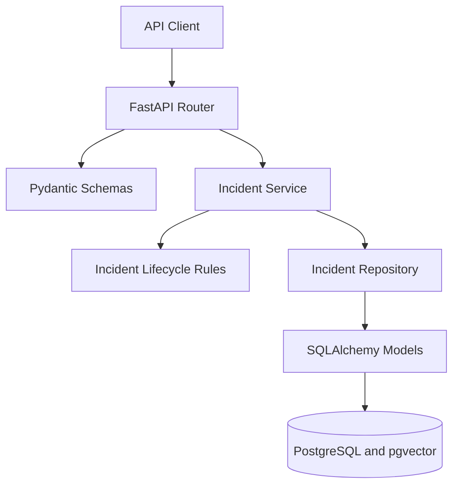
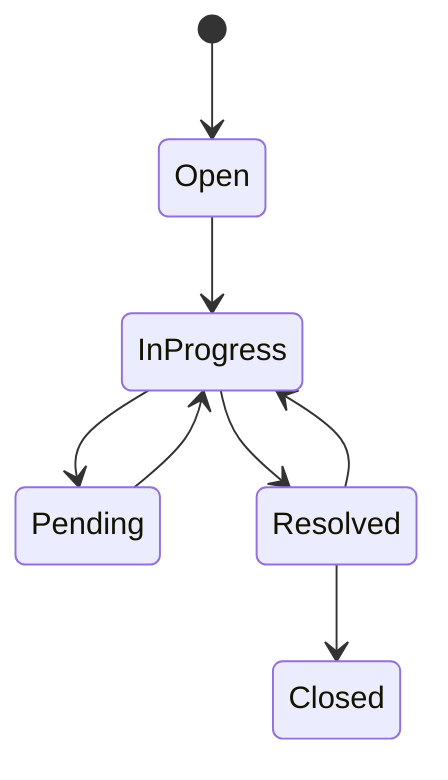

# Backend Architecture and Development Guide

## Overview

The AI Support Engine backend provides the foundation for an
AI-powered technical support and incident management platform.

The current implementation includes persistent incident management,
request validation, business rules, database migrations, transaction
management, health monitoring, and automated quality verification.

AI classification, retrieval-augmented generation, authentication,
and frontend functionality are planned for later development stages.

## Technology Stack

| Component | Technology |
|---|---|
| Programming language | Python 3.14 |
| API framework | FastAPI |
| Data validation | Pydantic |
| ORM | SQLAlchemy |
| Database | PostgreSQL 17 |
| Vector extension | pgvector 0.8.7 |
| Database driver | Psycopg 3 |
| Database migrations | Alembic |
| Container infrastructure | Docker Compose |
| Automated testing | Pytest |
| Coverage reporting | pytest-cov |
| Linting and formatting | Ruff |
| Static type checking | Mypy |
| Continuous integration | GitHub Actions |

## Architecture

The backend uses a layered architecture that separates HTTP handling,
business logic, persistence, and infrastructure.



### API Layer

Handles HTTP requests, dependency injection, query parameters,
response serialization, and application error translation.

### Schema Layer

Validates incident creation and update requests, prevents invalid
field values, and defines consistent API response structures.

### Service Layer

Enforces incident lifecycle rules, manages database transaction
boundaries, and coordinates incident operations.

### Repository Layer

Encapsulates database queries, CRUD operations, pagination,
filtering, and record counting.

Repositories flush changes without independently committing
transactions. Transaction ownership belongs to the service layer.

### Infrastructure Layer

Provides environment-based configuration, database connection
pooling, session management, migrations, and readiness checks.

## Project Structure

```text
backend/
  app/
    api/
      dependencies.py
      v1/
        incidents.py
    core/
      base.py
      config.py
      database.py
      exceptions.py
    models/
      enums.py
      incident.py
    repositories/
      incident.py
    schemas/
      incident.py
      pagination.py
    services/
      incident.py
      incident_lifecycle.py
    main.py
  migrations/
    versions/
    env.py
  tests/
    integration/
  alembic.ini
  pyproject.toml
```

## Local Development

### Prerequisites

- Python 3.14
- Docker with Docker Compose
- Git

Run the following commands from the repository root using PowerShell.

### Install Dependencies

```powershell
python -m venv backend/.venv

.\backend\.venv\Scripts\python.exe -m pip install --upgrade pip

.\backend\.venv\Scripts\python.exe -m pip install -e "backend[dev]"
```

### Configure the Environment

```powershell
Copy-Item .env.example .env
```

Configure a strong local PostgreSQL password in the new `.env` file
before starting the database for the first time.

Never commit the `.env` file or expose database credentials.

Changing the password in `.env` does not automatically change the
password of a database role in an existing initialized Docker volume.

### Start PostgreSQL

```powershell
docker compose up -d
docker compose ps
```

### Apply Database Migrations

```powershell
.\backend\.venv\Scripts\python.exe -m alembic -c backend/alembic.ini upgrade head
```

### Start the API

```powershell
.\backend\.venv\Scripts\python.exe -m uvicorn app.main:app --reload --app-dir backend
```

Local API resources:

- Swagger UI: http://127.0.0.1:8000/docs
- ReDoc: http://127.0.0.1:8000/redoc
- OpenAPI schema: http://127.0.0.1:8000/openapi.json

## HTTP API

| Method | Endpoint | Success Status |
|---|---|---|
| GET | / | 200 |
| GET | /health | 200 |
| GET | /ready | 200 |
| POST | /api/v1/incidents | 201 |
| GET | /api/v1/incidents | 200 |
| GET | /api/v1/incidents/{incident_id} | 200 |
| PATCH | /api/v1/incidents/{incident_id} | 200 |
| DELETE | /api/v1/incidents/{incident_id} | 204 |

### Create an Incident

Example request body:

```json
{
  "title": "Network connectivity issue",
  "description": "User cannot connect to the corporate network.",
  "priority": "high",
  "category": "Networking"
}
```

New incidents receive an automatically generated UUID, an open
status, and creation and update timestamps.

### Pagination and Filtering

Incident listing supports:

- offset: defaults to 0
- limit: defaults to 20, maximum 100
- status: optional status filter
- priority: optional priority filter
- category: optional exact category filter

Responses include items, total, offset, limit, and has_more.

Results are ordered by creation timestamp and UUID in descending
order to provide deterministic ordering for a stable dataset.

### Error Handling

| Status | Meaning |
|---|---|
| 404 | Incident not found |
| 409 | Incident lifecycle conflict |
| 422 | Invalid request data |
| 503 | Database unavailable during readiness check |

Unexpected application errors may return HTTP 500.

## Incident Management

### Supported Priorities

- low
- medium
- high
- critical

### Incident Lifecycle



Unchanged statuses are permitted.

A resolution is required for resolved and closed incidents.
Resolving an incident automatically records a UTC resolution
timestamp. Reopening a resolved incident clears that timestamp.

Closing an incident preserves its existing resolution timestamp.
Closed incidents cannot transition to another status.

## Database Migrations

Current migration history:

| Revision | Purpose |
|---|---|
| 180b60b1ebd9 | Enable pgvector extension |
| 14a739ac0e2f | Create incidents table |

Check migration consistency:

```powershell
.\backend\.venv\Scripts\python.exe -m alembic -c backend/alembic.ini current

.\backend\.venv\Scripts\python.exe -m alembic -c backend/alembic.ini check
```

## Automated Testing

The Stage 5 local verification baseline consists of:

| Test category | Tests |
|---|---:|
| Configuration | 10 |
| Database management | 7 |
| System endpoints | 4 |
| Database readiness | 7 |
| Incident models | 11 |
| Incident schemas | 29 |
| Incident repository | 11 |
| Incident lifecycle | 25 |
| Incident service | 17 |
| Incident REST API | 26 |
| API dependencies | 1 |
| PostgreSQL infrastructure | 6 |
| Repository integration | 10 |
| Service integration | 9 |
| End-to-end API integration | 7 |
| Total | 180 |

Local verification recorded 180 passing tests and 100% statement
coverage across 334 application statements.

Statement coverage does not establish complete branch coverage,
security assurance, or production readiness.

### Run Unit Tests

```powershell
.\backend\.venv\Scripts\python.exe -m pytest backend/tests --cov=app --cov-report=term-missing --cov-fail-under=80
```

Without integration testing enabled, the current suite executes
148 tests and skips 32 PostgreSQL integration tests.

### Run PostgreSQL Integration Tests

Create the isolated test database once:

```powershell
docker compose exec postgres psql -U ai_support_user -d postgres -c "CREATE DATABASE ai_support_engine_migration_test;"
```

If the database already exists, skip its creation.

```powershell
$env:POSTGRES_DB = "ai_support_engine_migration_test"
$env:RUN_INTEGRATION_TESTS = "1"

try {
    .\backend\.venv\Scripts\python.exe -m alembic -c backend/alembic.ini upgrade head

    .\backend\.venv\Scripts\python.exe -m pytest backend/tests --cov=app --cov-report=term-missing --cov-fail-under=80
}
finally {
    Remove-Item Env:POSTGRES_DB
    Remove-Item Env:RUN_INTEGRATION_TESTS
}
```

Integration fixtures verify the database name before executing tests.
Uncommitted repository changes are rolled back. Committed service
and API test records are removed using isolated test categories.

Never run integration tests against a production database.

## Code Quality

```powershell
.\backend\.venv\Scripts\python.exe -m pip check

.\backend\.venv\Scripts\python.exe -m ruff check backend

.\backend\.venv\Scripts\python.exe -m ruff format --check backend

.\backend\.venv\Scripts\python.exe -m mypy --config-file backend/pyproject.toml backend/app backend/tests backend/migrations
```

## Continuous Integration

The updated GitHub Actions workflow is designed to:

1. Provision PostgreSQL with pgvector.
2. Install Python and backend dependencies.
3. Verify dependency integrity.
4. Execute Ruff linting and formatting checks.
5. Execute strict Mypy type checking.
6. Apply and validate Alembic migrations.
7. Run unit and PostgreSQL integration tests.
8. Enforce a minimum statement coverage threshold of 80%.
9. Upload JUnit and coverage XML reports.

Remote execution must be verified before merging the Stage 5
feature branch.

## Current Limitations

The application is a development-stage backend foundation.

The following capabilities remain planned:

- Authentication and role-based authorization
- Incident audit history
- Concurrent update protection
- Production-grade deletion and retention policies
- AI incident classification
- Knowledge base and vector similarity retrieval
- AI-generated resolution recommendations
- Automated support workflows
- Frontend dashboard
- Production observability and deployment

The unauthenticated development API should not be exposed publicly.
