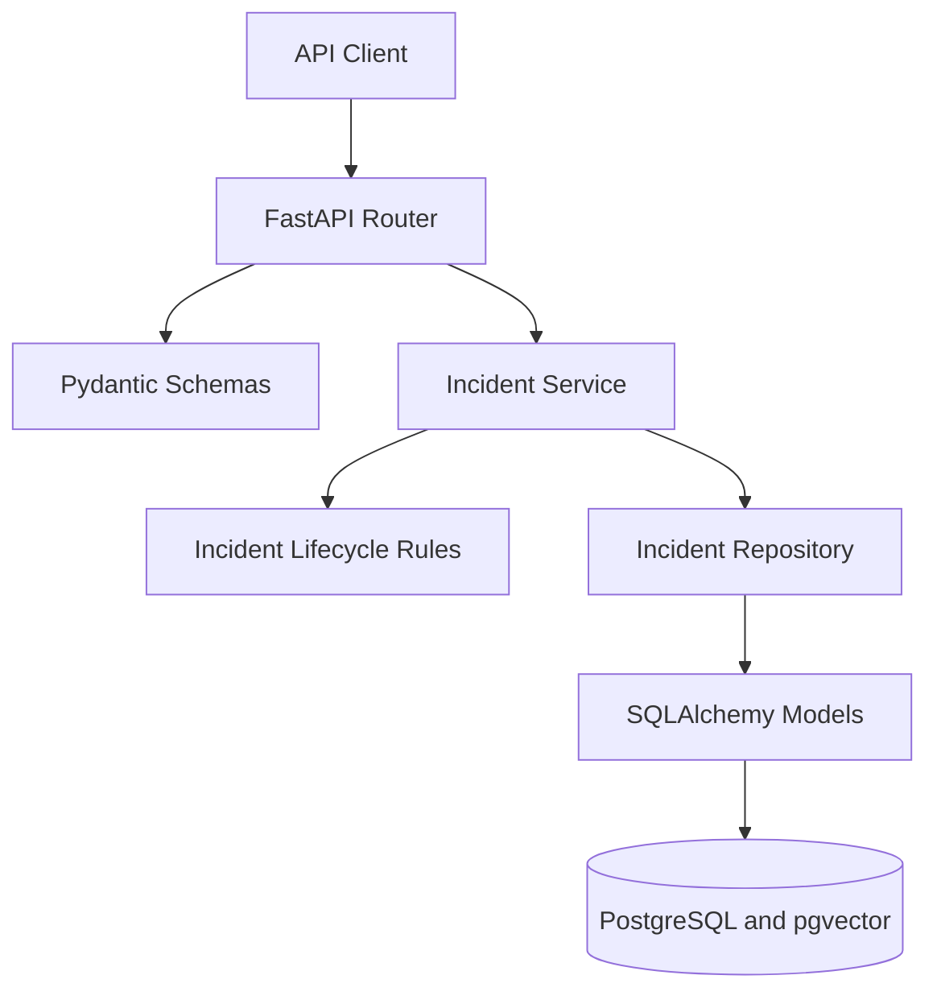
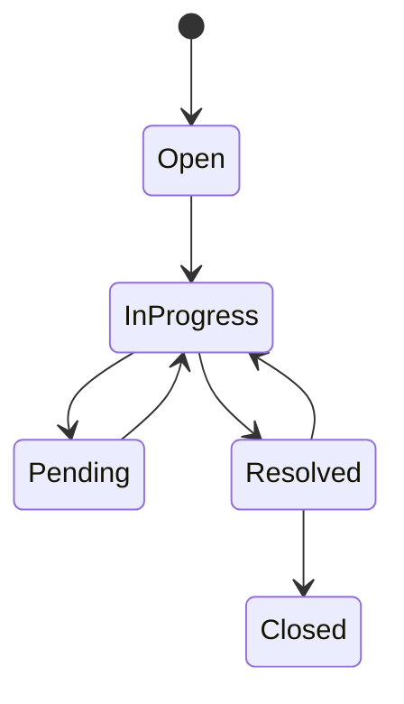

# Backend Architecture and Development Guide

## Overview

The AI Support Engine backend provides the foundation for an
AI-powered technical support and incident management platform.

The current implementation includes persistent incident management,
request validation, business rules, database migrations, transaction
management, health monitoring, and automated quality verification.

Structured AI incident analysis, persistent analysis history,
application log ingestion, diagnostic evidence extraction,
and log-enhanced AI analysis are implemented.

Retrieval-augmented generation, authentication, authorization,
and frontend functionality remain future work.

## Technology Stack

| Component | Technology |
|---|---|
| Programming language | Python 3.14.7 |
| API framework | FastAPI |
| Data validation | Pydantic |
| ORM | SQLAlchemy |
| Database | PostgreSQL 17 |
| Vector extension | pgvector 0.8.7 |
| Database driver | Psycopg 3 |
| Database migrations | Alembic |
| Container infrastructure | Docker Compose |
| Automated testing | Pytest |
| Coverage reporting | pytest-cov |
| Linting and formatting | Ruff |
| Static type checking | Mypy |
| Continuous integration | GitHub Actions |

## Architecture

The backend uses a layered architecture that separates HTTP handling,
business logic, persistence, and infrastructure.



### API Layer

Handles HTTP requests, dependency injection, query parameters,
response serialization, and application error translation.

### Schema Layer

Validates incident creation and update requests, prevents invalid
field values, and defines consistent API response structures.

### Service Layer

Enforces incident lifecycle rules, manages database transaction
boundaries, and coordinates incident operations.

### Repository Layer

Encapsulates database queries, CRUD operations, pagination,
filtering, and record counting.

Repositories flush changes without independently committing
transactions. Transaction ownership belongs to the service layer.

### Infrastructure Layer

Provides environment-based configuration, database connection
pooling, session management, migrations, and readiness checks.

## Project Structure

```text
backend/
  app/
    api/
      dependencies.py
      v1/
        incidents.py
    core/
      base.py
      config.py
      database.py
      exceptions.py
    models/
      enums.py
      incident.py
    repositories/
      incident.py
    schemas/
      incident.py
      pagination.py
    services/
      incident.py
      incident_lifecycle.py
    main.py
  migrations/
    versions/
    env.py
  tests/
    integration/
  alembic.ini
  pyproject.toml
```

## Local Development

### Prerequisites

- CPython 3.14.7
- Docker with Docker Compose
- Git

Run the following commands from the repository root using PowerShell.

### Install Dependencies

```powershell
python -m venv backend/.venv

.\backend\.venv\Scripts\python.exe -m pip install --only-binary=:all: -r backend/build-requirements.txt

.\backend\.venv\Scripts\python.exe -m pip install --only-binary=:all: -c backend/constraints.txt -e "backend[dev]"
```

The project declares runtime and development dependencies in
`backend/pyproject.toml`. Exact dependency versions are maintained
in `backend/constraints.txt`, while build tools are pinned in
`backend/build-requirements.txt`.

The verified build tools are pip 26.2.1 and setuptools 84.2.1.
The setuptools build requirement is also pinned in pyproject.toml.

The constraints support the verified Windows AMD64 and Linux
x86_64 environments. They establish version reproducibility,
not cryptographically verified package artifacts.

Use a fresh virtual environment for clean-install acceptance.
Dependency upgrades require renewed resolution, installation,
static quality, and regression verification.

### Configure the Environment

```powershell
Copy-Item .env.example .env
```

Configure a strong local PostgreSQL password in the new `.env` file
before starting the database for the first time.

Never commit the `.env` file or expose database credentials.

Changing the password in `.env` does not automatically change the
password of a database role in an existing initialized Docker volume.

### Start PostgreSQL

```powershell
docker compose up -d
docker compose ps
```

### Apply Database Migrations

```powershell
.\backend\.venv\Scripts\python.exe -m alembic -c backend/alembic.ini upgrade head
```

### Start the API

```powershell
.\backend\.venv\Scripts\python.exe -m uvicorn app.main:app --reload --app-dir backend
```

Local API resources:

- Swagger UI: http://127.0.0.1:8000/docs
- ReDoc: http://127.0.0.1:8000/redoc
- OpenAPI schema: http://127.0.0.1:8000/openapi.json

## HTTP API

| Method | Endpoint | Success Status |
|---|---|---|
| GET | / | 200 |
| GET | /health | 200 |
| GET | /ready | 200 |
| POST | /api/v1/incidents | 201 |
| GET | /api/v1/incidents | 200 |
| GET | /api/v1/incidents/{incident_id} | 200 |
| PATCH | /api/v1/incidents/{incident_id} | 200 |
| DELETE | /api/v1/incidents/{incident_id} | 204 |

### Create an Incident

Example request body:

```json
{
  "title": "Network connectivity issue",
  "description": "User cannot connect to the corporate network.",
  "priority": "high",
  "category": "Networking"
}
```

New incidents receive an automatically generated UUID, an open
status, and creation and update timestamps.

### Pagination and Filtering

Incident listing supports:

- offset: defaults to 0
- limit: defaults to 20, maximum 100
- status: optional status filter
- priority: optional priority filter
- category: optional exact category filter

Responses include items, total, offset, limit, and has_more.

Results are ordered by creation timestamp and UUID in descending
order to provide deterministic ordering for a stable dataset.

### Error Handling

| Status | Meaning |
|---|---|
| 404 | Incident not found |
| 409 | Incident lifecycle conflict |
| 422 | Invalid request data |
| 503 | Database unavailable during readiness check |

Unexpected application errors may return HTTP 500.

## Incident Management

### Supported Priorities

- low
- medium
- high
- critical

### Incident Lifecycle



Unchanged statuses are permitted.

A resolution is required for resolved and closed incidents.
Resolving an incident automatically records a UTC resolution
timestamp. Reopening a resolved incident clears that timestamp.

Closing an incident preserves its existing resolution timestamp.
Closed incidents cannot transition to another status.

## Database Migrations

Current migration history is documented in the [Stage 7 migration history](#database-migration-history) below.

Check migration consistency:

```powershell
.\backend\.venv\Scripts\python.exe -m alembic -c backend/alembic.ini current

.\backend\.venv\Scripts\python.exe -m alembic -c backend/alembic.ini check
```

## Automated Testing

The historical Stage 5 local verification baseline consisted of:

| Test category | Tests |
|---|---:|
| Configuration | 10 |
| Database management | 7 |
| System endpoints | 4 |
| Database readiness | 7 |
| Incident models | 11 |
| Incident schemas | 29 |
| Incident repository | 11 |
| Incident lifecycle | 25 |
| Incident service | 17 |
| Incident REST API | 26 |
| API dependencies | 1 |
| PostgreSQL infrastructure | 6 |
| Repository integration | 10 |
| Service integration | 9 |
| End-to-end API integration | 7 |
| Total | 180 |

Local verification recorded 180 passing tests and 100% statement
coverage across 334 application statements.

Statement coverage does not establish complete branch coverage,
security assurance, or production readiness.

### Run Unit Tests

```powershell
.\backend\.venv\Scripts\python.exe -m pytest backend/tests --ignore=backend/tests/integration -W error::DeprecationWarning --tb=short -q
```

This command excludes the PostgreSQL integration directory.
It is intended for focused development verification and does
not establish complete CI acceptance or full application coverage.

The historical Stage 5 suite executed 148 tests and skipped
32 integration tests when integration testing was disabled.
Those counts are not the current regression baseline.

### Run PostgreSQL Integration Tests

Create the isolated test database once:

```powershell
docker compose exec postgres psql -U ai_support_user -d postgres -c "CREATE DATABASE ai_support_engine_migration_test;"
```

If the database already exists, skip its creation.

```powershell
$previousDatabase = $env:POSTGRES_DB
$previousIntegration = $env:RUN_INTEGRATION_TESTS

try {
    $env:POSTGRES_DB = "ai_support_engine_migration_test"
    $env:RUN_INTEGRATION_TESTS = "1"

    .\backend\.venv\Scripts\python.exe -c "from app.core.database import get_database_url; assert get_database_url().database == 'ai_support_engine_migration_test'"
    if ($LASTEXITCODE -ne 0) { throw "Database identity check failed." }

    .\backend\.venv\Scripts\python.exe -m alembic -c backend/alembic.ini upgrade head
    if ($LASTEXITCODE -ne 0) { throw "Migration failed." }

    .\backend\.venv\Scripts\python.exe -m alembic -c backend/alembic.ini check
    if ($LASTEXITCODE -ne 0) { throw "Schema consistency check failed." }

    .\backend\.venv\Scripts\python.exe -m pytest backend/tests --cov=app --cov-report=term-missing --cov-fail-under=100 -W error::DeprecationWarning --tb=short -q
    if ($LASTEXITCODE -ne 0) { throw "Regression failed." }
}
finally {
    $env:POSTGRES_DB = $previousDatabase
    $env:RUN_INTEGRATION_TESTS = $previousIntegration
}
```

Integration fixtures verify the database name before executing tests.
Uncommitted repository changes are rolled back. Committed service
and API test records are removed using isolated test categories.

Never run integration tests against a development or production
database. Verify the configured database host and isolated test
database identity before applying migrations or executing tests.

The local command enforces the coverage threshold and treats
deprecation warnings as errors. Complete CI acceptance additionally
validates the generated JUnit and coverage XML reports for zero
skipped tests and zero missed application statements.

## Code Quality

```powershell
.\backend\.venv\Scripts\python.exe -m pip check

.\backend\.venv\Scripts\python.exe -m ruff check backend

.\backend\.venv\Scripts\python.exe -m ruff format --check backend

.\backend\.venv\Scripts\python.exe -m mypy --config-file backend/pyproject.toml backend/app backend/tests backend/migrations
```

## Continuous Integration

The workflow is defined in `.github/workflows/backend-ci.yml`.

It is configured to:

1. Check out the repository with read-only contents permissions.
2. Provision PostgreSQL 17 with pgvector 0.8.7.
3. Install Python 3.14.7 and create an isolated virtual environment.
4. Install pinned build tools and constrained backend dependencies.
5. Verify dependency integrity and the exact Linux package inventory.
6. Execute full backend Ruff linting and formatting checks.
7. Execute strict Mypy checks for application, tests, and migrations.
8. Apply and validate Alembic migrations.
9. Run all unit and PostgreSQL integration tests, treating
   deprecation warnings as errors.
10. Require exact 100% application statement coverage and zero
    failed, errored, or skipped tests through XML report validation.
11. Upload JUnit and coverage XML reports.

The workflow enables integration testing against
`ai_support_engine_migration_test`.

All 11 executable workflow steps passed local Linux CI-equivalent
acceptance using a fresh PostgreSQL instance. GitHub-specific
checkout, setup, caching, artifact upload, and runner timeout
behavior were not reproduced by the local acceptance harness.

Actual GitHub Actions execution must pass before merging
the Stage 7 feature branch.

## Current Limitations

The application is a development-stage backend foundation.

The following capabilities remain planned:

- Authentication and role-based authorization
- Incident audit history
- Comprehensive concurrent update and load verification
- Production-grade deletion and retention policies
- Knowledge base and vector similarity retrieval
- Documentation-backed remediation recommendations
- Automated support workflows
- Frontend dashboard
- Production observability and deployment

The unauthenticated development API should not be exposed publicly.

## Stage 7 Application Log API

All log endpoints are scoped to an existing incident.

| Method | Endpoint | Purpose |
| --- | --- | --- |
| POST | /api/v1/incidents/{incident_id}/logs | Ingest logs |
| GET | /api/v1/incidents/{incident_id}/logs | List submissions |
| GET | /api/v1/incidents/{incident_id}/logs/{submission_id} | Retrieve submission |
| DELETE | /api/v1/incidents/{incident_id}/logs/{submission_id} | Delete submission |
| GET | /api/v1/incidents/{incident_id}/logs/{submission_id}/entries | List entries |
| GET | /api/v1/incidents/{incident_id}/logs/{submission_id}/entries/{entry_id} | Retrieve entry |
| GET | /api/v1/incidents/{incident_id}/logs/{submission_id}/evidence | Retrieve evidence |

Ingestion accepts a raw UTF-8 request body with the required
source_format query parameter.

Supported formats are text, JSON, and XML. The Content-Type
header must match the selected format.

The optional X-Log-Source-Name header accepts printable
ASCII and is sanitized before persistence.

Submission and entry retrieval support bounded pagination.

Consult /docs and /openapi.json for generated API contracts.

### Database Migration History

| Revision | Purpose |
| --- | --- |
| 180b60b1ebd9 | Enable pgvector |
| 14a739ac0e2f | Create incidents |
| 421c4f9ba04a | Create AI analyses |
| c150a35f0639 | Create log tables |
| 8e47c2a19b60 | Add AI evidence provenance |

The Stage 7 migration head is 8e47c2a19b60.

Integration tests must use ai_support_engine_migration_test,
never the development or production database.

The development database was upgraded from c150a35f0639
to 8e47c2a19b60 through a separately verified additive
migration. The integration database remained unchanged.

See [Log Ingestion Architecture](log-ingestion-architecture.md).

## Stage 7 Acceptance Baseline

### Automated Regression

| Metric | Windows baseline | Isolated Linux CI-equivalent run |
| --- | ---: | ---: |
| Passing tests | 15,415 | 15,415 |
| Application statements covered | 2,781/2,781 | 2,781/2,781 |
| Statement coverage | 100% | 100% |
| Failed or skipped tests | 0 | 0 |
| Regression duration | 312.85 s | 217.54 s |

The Windows baseline preceded the final test typing corrections.
A subsequent targeted regression passed all 2,559 tests across
the nine corrected modules. The complete Linux regression
then reproduced the full test and coverage baseline.

The historical Windows regression included 2,366 PostgreSQL
integration tests.

### Static Quality and Dependencies

- Ruff linting: passed.
- Ruff formatting: 221 files checked.
- Strict Mypy: 219 application, test, and migration source files.
- Strict Mypy errors: zero.
- Python dependency integrity: passed.
- Clean Windows installation: 51 expected distributions verified.
- Clean Linux installation: 50 expected distributions verified.
- Shared dependency version mismatches: zero.

Both installation environments used Python 3.14.7,
pip 26.2.1, and setuptools 84.2.1. The project maintains
49 exact-version dependency constraints, including
platform-specific requirements.

### Database and CI Acceptance

- Five migration upgrades and downgrades previously verified
  against an isolated migration acceptance database.
- All five migrations applied to a fresh Linux PostgreSQL instance.
- Migration head: 8e47c2a19b60.
- PostgreSQL 17.12 and pgvector 0.8.7 verified in Linux.
- Alembic consistency: no new upgrade operations detected.
- Zero residual application records after regression.
- All 11 executable CI workflow steps passed.
- Exact 100% statement coverage and zero skipped tests enforced.

The CI-equivalent acceptance was executed locally in Docker
using an isolated database instance and the workflow's executable
shell commands. It was not a GitHub-hosted Actions run.

### Remaining Limitations

Statement coverage does not establish complete branch,
behavioral, or security coverage.

Automated AI tests use synthetic responses and intercepted
transport. Live provider accuracy, latency, and billing
remain unverified.

The local development database has been upgraded to revision
8e47c2a19b60. Independent post-migration verification confirmed
matching development and integration schemas, zero ORM schema
differences, and preservation of existing application records.

Both databases contained zero application records at acceptance.
A pre-migration PostgreSQL backup was created and its archive
inventory and integrity were verified. A restore rehearsal was
not performed.

Actual GitHub Actions execution and feature branch merge
remain pending.
